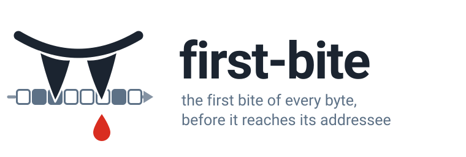
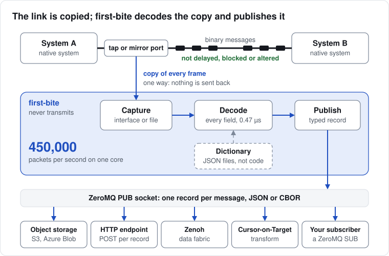
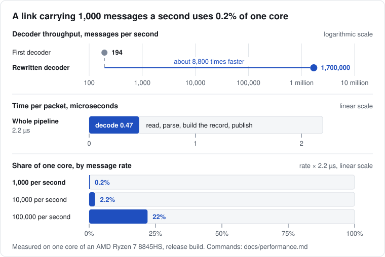

# first-bite

<picture>
  <source media="(prefers-color-scheme: dark)" srcset="./icon/first-bite-wordmark-dark.svg">
  
</picture>

<picture>
  <source media="(prefers-color-scheme: dark)" srcset="docs/img/how-it-works-dark.svg">
  
</picture>

**first-bite takes binary messages off the wire and hands them, decoded, to
anything that can read JSON from a socket.** It listens on a network tap or
mirror port, decodes each fixed-layout message against a dictionary, and
publishes one JSON record per message on a ZeroMQ PUB socket. Sinks forward the
records to S3-compatible storage, Azure Blob, an HTTP endpoint, a Zenoh data
fabric or a file, and a transform emits Cursor-on-Target.

The name says what it does: it takes the first bite of every byte while it is still
on the wire, before the addressee does, and takes nothing from it. It never
transmits on the capture interface. On a passive tap there is no path
from the monitor ports back to the link, so the systems exchanging the messages
are not delayed, blocked or altered, and the link is unaffected if first-bite
stops. One core handles 340,000 packets per second, so a link carrying 1,000
messages per second uses about 0.3% of it. It was built to open up the traffic
of a tactical local network that until then was visible only to the systems
exchanging it.

[Interactive decoder](https://usareur-af.github.io/first-bite/decoder/) ·
[Documentation](https://usareur-af.github.io/first-bite/) ·
[Ten-page brief (PDF)](docs/brief/first-bite-brief.pdf)

## The numbers

Measured on one core of an AMD Ryzen 7 8845HS with a release build;
[docs/performance.md](docs/performance.md) has the command behind each figure.

| | Measured |
|---|---|
| Decode one message: identify it, extract every field, render the values | **0.69 µs**: 1.45 million messages, 9.3 million fields per second |
| Whole pipeline: read a frame, parse Ethernet/IP/UDP, decode, build the JSON record, publish | **2.9 µs**: 340,000 packets per second |
| A link carrying 1,000 messages per second | about **0.3%** of one core |
| Memory while replaying a 145 MB capture | **10.7 MB** resident |
| Live capture on two interfaces at once | **500 of 500** packets decoded, none dropped |
| The binary | **16.5 MB**, one file, needs only glibc |
| This project's first decoder against the current one, same recorded messages | 194 against **1,700,000** messages per second |

<picture>
  <source media="(prefers-color-scheme: dark)" srcset="docs/img/performance-dark.svg">
  
</picture>

## How it works

The message set is data, not code. A dictionary is a directory of JSON files
that gives the bit range, type and value labels of every field, so the same
binary decodes a weather station's UDP reports, the frames on a vehicle CAN bus
or a message set of your own. Decoding a message is two hash lookups (the
interface by port, the message by its type) and one bit extraction per field.

<picture>
  <source media="(prefers-color-scheme: dark)" srcset="docs/img/frame-to-record-dark.svg">
  
</picture>

One decode serves every consumer. A consumer subscribes to the record socket,
or reads what a sink wrote; it does not implement the binary interface and
holds no connection to the systems on the link.

<picture>
  <source media="(prefers-color-scheme: dark)" srcset="docs/img/one-decode-many-consumers-dark.svg">
  
</picture>

## Try it

Needs a Rust toolchain, a C/C++ compiler, CMake and the libpcap headers
(`libpcap-dev` on Debian and Ubuntu; included on macOS).

```bash
make build

# Validate a dictionary and run its test vectors.
cargo run -p bite -- check dictionaries/weather-station

# Decode one payload by hand.
cargo run -p bite -- decode dictionaries/weather-station --port 40100 \
    0200174b583700fb2e18bcda9b4236000004030201beef

# Replay a capture file through the whole pipeline; records go to
# completelog_<time>.log and to ZeroMQ on tcp://*:12000.
cargo run -p mind -- --pcap-file examples/weather-station.pcap \
    --dictionary dictionaries/weather-station --output
```

The decode command prints:

```json
{
  "fields": {
    "checksum": "beef",
    "humidity": 45.5,
    "message_length": 23,
    "message_type": "Observation",
    "pressure": 101325,
    "sample_serial": 16909060,
    "station_id": "KX7",
    "temperature": -12.34,
    "wind_direction": 271.5
  },
  "interface": "WX",
  "message_type": "Observation"
}
```

## Install a release

Download the archive for the machine from the releases page; none needs a
package installed first. [docs/deployment.md](docs/deployment.md) has the
installer, the layout of each archive and how they are built.

| Platform | Archive | Status |
|---|---|---|
| Ubuntu 20.04 to 26.04, or any Linux with glibc 2.31 or later | `x86_64-linux-gnu`, `aarch64-linux-gnu` | x86-64 built and run on the build host; Arm built in CI, not run locally |
| Linux with no glibc or an older one (Alpine, busybox, a cut-down system) | `x86_64-linux-musl`, `aarch64-linux-musl`: fully static, published with each `X.Y.0` release | x86-64 built and run on the build host; Arm built in CI, not run locally |
| macOS | `aarch64-apple-darwin`, `x86_64-apple-darwin` | built in CI; not run locally |
| Windows | `x86_64-pc-windows-msvc`: `bite.exe` only | built in CI; not run locally |
| iOS, iPadOS, Android, a browser | none: the `bite` library compiles for them | compile-checked; no application built |

iOS, iPadOS and Android do not allow an app to capture from a network
interface without root or a VPN entitlement, so on those platforms the decoder
library is what runs, not `mind`.

## Run it on a network

```bash
make release
sudo BITE_DICT_PATH=/path/to/dictionary ./target/release/mind eth0
```

| Option | Meaning |
|---|---|
| `<interface>` | capture on a network interface (needs capture privileges) |
| `--pcap-file <file>` | read a pcap or pcapng file, then exit |
| `--mock` | read Ethernet frames from a UDP socket (`--mock-address`, default `0.0.0.0:12345`) |
| `--dictionary <dir>` | dictionary directory; overrides `BITE_DICT_PATH` |
| `--filter <bpf>` | capture filter, for example `"udp port 40100"` |
| `--no-promiscuous` | capture only frames addressed to this host |
| `--env-file <file>` | load `KEY=VALUE` lines into the environment first |
| `--output` | also write every record to `completelog_<time>.log` |
| `--activate-subpubs` | run the transforms in the subpub configuration |

Configuration read from the environment:

| Variable | Meaning |
|---|---|
| `BITE_DICT_PATH` | dictionary directory |
| `PUBLISHER_CONFIG_PATH` | ZeroMQ publishers; default is one PUB socket on `tcp://*:12000` |
| `SUBSCRIBER_CONFIG_PATH` | sinks; none when unset |
| `SUBPUB_CONFIG_PATH` | transforms, used with `--activate-subpubs` |
| `DATA_SOURCE_NETWORK_NAME`, `DATA_SOURCE_GEO_LOCATION`, `DATA_SOURCE_SYSTEM_TYPE`, `DATA_SOURCE_OWNER`, `DATA_PACKET_CLASSIFICATION`, `DATA_PACKET_ACCM` | copied into every record |
| `RUST_LOG` | log level, for example `warn,mind=info` |

Example configuration files are in [`flow/config/`](flow/config); a systemd
unit and install script are in [`deployment/`](deployment).

On a tap, name both capture interfaces (`mind enp3s0 enp4s0`); `mind` logs what
the kernel, the interface and its own queue dropped, per interface.
[docs/tap.md](docs/tap.md) covers tap choice, interface preparation and the
loss counters; [docs/deployment.md](docs/deployment.md) covers the release
archives, the systemd service, the container and building without internet
access.

## Write a dictionary

Start from [`dictionaries/weather-station`](dictionaries/weather-station) and
[docs/dictionary-format.md](docs/dictionary-format.md). One interface is one
directory with a `metadata.json` and a `messages/` directory; one message is
one file:

```json
{
    "description": "Sent every ten seconds while the station is powered.",
    "fields": {
        "uptime":       {"start": 56, "stop": 88, "unit": "s"},
        "battery_low":  {"start": 88, "stop": 89, "type": "bool"},
        "mode":         {"start": 90, "stop": 92,
                         "values": {"0": "Idle", "1": "Sampling", "2": "Calibrating"}}
    }
}
```

Put payloads and what they must decode to in `vectors/`, and `bite check` runs
them. A dictionary does not have to live in this repository: point
`BITE_DICT_PATH` at any directory. Keep a dictionary for a message set you may
not publish in a repository of your own.

## Beyond IP

The decoder takes a payload and, optionally, a frame identifier, and does not
care where they came from. Decoding CAN-style frames (identifier as the
discriminator, little-endian `lsb0` signals) is built and measured at 1.40
million frames per second with [`dictionaries/vehicle-can`](dictionaries/vehicle-can).
A SocketCAN capture source is designed, not built; sources for other buses are
not built. [docs/architecture.md](docs/architecture.md#beyond-ip) has the table.

## Layout

| Path | What |
|---|---|
| [`bite/`](bite) | the decoder library and the `bite` command |
| [`mind/`](mind) | the `mind` binary: sources, pipeline, capture loop |
| [`flow/`](flow) | ZeroMQ publishers, sinks and transforms |
| [`cotify/`](cotify) | Cursor-on-Target output |
| [`dictionaries/`](dictionaries) | example dictionaries with vectors |
| [`docs/`](docs) | [architecture](docs/architecture.md), [dictionary format](docs/dictionary-format.md), [performance](docs/performance.md), [tap](docs/tap.md), [deployment](docs/deployment.md), [related projects](docs/related-projects.md), [illustrations](docs/img), [brief](docs/brief) |
| [`site/`](site) | the documentation site; `make site` builds it |
| [`deployment/`](deployment) | systemd unit, install script, log shipping |
| [`mocks/`](mocks) | local stand-ins for the sinks |

## Contributing

[CONTRIBUTING.md](CONTRIBUTING.md) is the whole process. Report
vulnerabilities through [SECURITY.md](SECURITY.md), not an issue.

## Licence

[Apache License 2.0](LICENSE); see [NOTICE](NOTICE) and [INTENT.md](INTENT.md).
