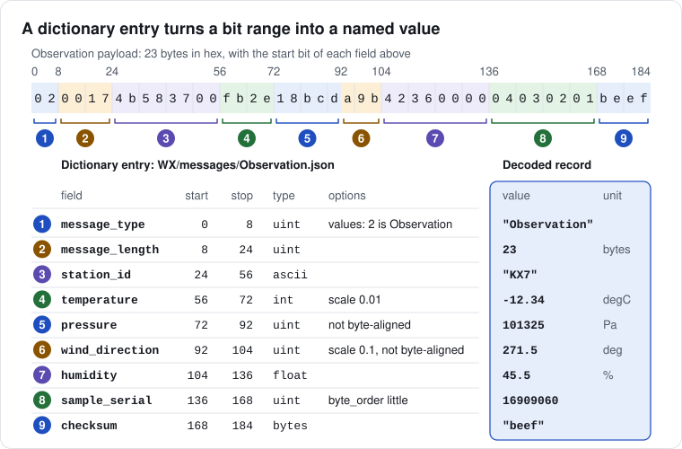
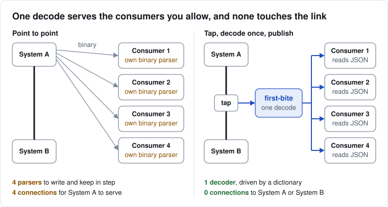

# first-bite

<picture>
  <source media="(prefers-color-scheme: dark)" srcset="./icon/first-bite-wordmark-dark.svg">
  
</picture>

[](https://github.com/USAREUR-AF/first-bite/actions/workflows/ci.yml)
[](https://scorecard.dev/viewer/?uri=github.com/USAREUR-AF/first-bite)
[](https://www.bestpractices.dev/projects/16721)
[](https://github.com/USAREUR-AF/first-bite/actions/workflows/cflite_batch.yml)
[](https://github.com/USAREUR-AF/first-bite/actions/workflows/rust-audit.yml)
[](https://github.com/USAREUR-AF/first-bite/actions/workflows/cargo-deny.yml)
[](LICENSE)
[](https://usareur-af.github.io/first-bite/)
<!-- To add when the first release exists (docs/security/scorecard.md):
[](https://github.com/USAREUR-AF/first-bite/releases/latest)
-->

<picture>
  <source media="(prefers-color-scheme: dark)" srcset="docs/img/how-it-works-dark.svg">
  
</picture>

**first-bite takes binary messages off the wire and hands them, decoded, to
the software their owner authorises.** It listens on a network tap or a
switch mirror port, local or tunnelled (ERSPAN, GRE or VXLAN), decodes each
fixed-layout message against a dictionary, and publishes one record per
message on a ZeroMQ PUB socket: typed values, as JSON by default or CBOR. Sinks forward the records to S3-compatible
storage, Azure Blob, an HTTP endpoint, a Zenoh data fabric or a file, and a
transform emits Cursor-on-Target. Records stay on the machine until its owner
configures a destination: the record socket binds loopback by default and no
sink runs unless one is configured. The record socket is plaintext and
unauthenticated and stays on the host; other hosts are served by the Zenoh
sink or an HTTPS sink, and a `security` block in the configuration states the
level every path is held to (TLS or mutual TLS, minimum TLS version, hybrid
post-quantum key exchange, the FIPS module). `mind` refuses to start when a
path cannot meet it. [docs/security/transport.md](docs/security/transport.md)
is the guide.

The name says what it does: it takes the first bite of every byte while it is
still on the wire, before the addressee does, and takes nothing from it. It
never transmits on the capture interface. On a passive tap there is no path
from the monitor ports back to the link, so the systems exchanging the messages
are not delayed, blocked or altered, and the link is unaffected if first-bite
stops. A mirror port leaves forwarding as it was, but the switch does the
copying and drops mirrored frames first when it is busy; a remote mirror also
puts the mirrored traffic on the network that carries its tunnel. One core
handles 450,000 packets per second, so a link carrying 1,000 messages per
second uses about 0.2% of it.

[Interactive decoder](https://usareur-af.github.io/first-bite/decoder/) ·
[Documentation](https://usareur-af.github.io/first-bite/) ·
[Technical brief (PDF)](docs/brief/first-bite-brief.pdf) ·
[Roadmap](ROADMAP.md) ·
[Project board](https://github.com/orgs/USAREUR-AF/projects/12)

## Opening up systems you cannot change

A great deal of fielded equipment exchanges data in a one-off binary wire
format, defined once in an interface document and compiled into both ends:
radar and surveillance feeds, vehicle and avionics data buses, industrial and
utility control systems. Those systems work, and they are expensive to change.
Altering certified, safety-critical software means repeating years of testing
and qualification, so the data stays sealed between the two machines built to
exchange it, and every new consumer needs its own point-to-point integration.

first-bite does not change them. It reads a copy of what is already on the
wire, decodes it from a description of the format kept as data, and publishes
it. Monitoring, analytics, migration testing and new consumers can be added
around a certified system, and because nothing on that system changes, there
is nothing about it to qualify again. first-bite observes and commands
nothing. It decodes fixed-layout messages today; variable-length and repeated
structures are on the [roadmap](ROADMAP.md).

## The numbers

Measured on one core of an AMD Ryzen 7 8845HS with a release build of the
1.1.0 code, publishing version 2 JSON records, on 2026-11-15 with the machine
also running other work; [docs/performance.md](docs/performance.md) has the
command behind each figure.

| | Measured |
|---|---|
| Decode one message: identify it, extract every field, render the values | **0.47 µs**: 2.1 million messages, 13.6 million fields per second |
| Whole pipeline: read a frame, parse Ethernet/IP/UDP, decode, build the record, publish | **2.2 µs**: 450,000 packets per second |
| A link carrying 1,000 messages per second | about **0.2%** of one core |
| Memory while replaying a 145 MB capture | **10.9 MB** resident |
| Live capture on two interfaces at once | **500 of 500** packets decoded, none dropped |
| `mind`, portable build | **14.67 MB**, one file, needs only glibc |
| This project's first decoder against its rewrite, same recorded messages | 194 against **1,700,000** messages per second |

<picture>
  <source media="(prefers-color-scheme: dark)" srcset="docs/img/performance-dark.svg">
  
</picture>

## How it works

The message set is data, not code. A dictionary is a directory of JSON files
that gives the bit range, type and value labels of every field, so the same
binary decodes a weather station's UDP reports, the frames on a vehicle CAN bus
or a message set of your own. Decoding a message is two hash lookups (the
interface by port, the message by its type) and one bit extraction per field.

<picture>
  <source media="(prefers-color-scheme: dark)" srcset="docs/img/frame-to-record-dark.svg">
  
</picture>

One decode serves every consumer the owner allows. A consumer subscribes to the record socket,
or reads what a sink wrote; it does not implement the binary interface and
holds no connection to the systems on the link.

A record carries each decoded value with its type: a number, a boolean, a
label. The socket and each sink write it as JSON, or as CBOR where a smaller
record matters. [docs/record.md](docs/record.md) lists every field.

<picture>
  <source media="(prefers-color-scheme: dark)" srcset="docs/img/one-decode-many-consumers-dark.svg">
  
</picture>

## Try it

Needs a Rust toolchain, a C/C++ compiler, CMake and the libpcap headers
(`libpcap-dev` on Debian and Ubuntu; included on macOS).

```bash
make build

# Validate a dictionary and run its test vectors.
cargo run -p bite -- check dictionaries/weather-station

# Decode one payload by hand.
cargo run -p bite -- decode dictionaries/weather-station --port 40100 \
    0200174b583700fb2e18bcda9b4236000004030201beef

# Replay a capture file through the whole pipeline; records go to
# completelog_<time>.log and to ZeroMQ on tcp://127.0.0.1:12000.
cargo run -p mind -- --pcap-file examples/weather-station.pcap \
    --dictionary dictionaries/weather-station --output
```

The decode command prints:

```json
{
  "fields": {
    "checksum": "beef",
    "humidity": 45.5,
    "message_length": 23,
    "message_type": "Observation",
    "pressure": 101325,
    "sample_serial": 16909060,
    "station_id": "KX7",
    "temperature": -12.34,
    "wind_direction": 271.5
  },
  "interface": "WX",
  "message_type": "Observation"
}
```

To decode traffic your own network already carries, capture the Network Time
Protocol with [`dictionaries/ntp`](dictionaries/ntp/README.md#try-it-on-your-own-network):

```bash
sudo ./target/debug/mind eth0 --dictionary dictionaries/ntp --filter "udp port 123"
```

Each time a machine on the link sets its clock, `mind` logs two records: the
request (`"message_type":"client"`) and the server's reply, with its stratum,
its timestamps and its distance from a reference clock. `sntp pool.ntp.org`,
`ntpdate -q pool.ntp.org` or `sudo chronyc burst 1/1` provokes one.

## Install a release

Download the archive for the machine from the releases page; none needs a
package installed first. [docs/deployment.md](docs/deployment.md) has the
installer, the layout of each archive and how they are built.

| Platform | Archive | Status |
|---|---|---|
| Ubuntu 20.04 to 26.04, or any Linux with glibc 2.31 or later | `x86_64-linux-gnu`, `aarch64-linux-gnu` | x86-64 built and run on the build host; Arm built in CI, not run locally |
| Linux with no glibc or an older one (Alpine, busybox, a cut-down system) | `x86_64-linux-musl`, `aarch64-linux-musl`: fully static, published with each `X.Y.0` release | x86-64 built and run on the build host; Arm built in CI, not run locally |
| macOS | `aarch64-apple-darwin`, `x86_64-apple-darwin` | built in CI; not run locally |
| Windows | `x86_64-pc-windows-msvc`: `bite.exe` only | built in CI; not run locally |
| iOS, iPadOS, Android, a browser | none: the `bite` library compiles for them | compile-checked; no application built |
| a container host, x86-64 or 64-bit Arm | the image `ghcr.io/usareur-af/first-bite:<version>` | x86-64 built and run on the build host; Arm, and publishing, built in CI, not run |

```bash
docker pull ghcr.io/usareur-af/first-bite:<version>
gh attestation verify oci://ghcr.io/usareur-af/first-bite:<version> --repo USAREUR-AF/first-bite
```

The second command checks the image's signed build provenance.
[docs/deployment.md](docs/deployment.md#container) has the image's tags and
how to run it.

iOS, iPadOS and Android do not allow an app to capture from a network
interface without root or a VPN entitlement, so on those platforms the decoder
library is what runs, not `mind`.

## Run it on a network

```bash
make release
sudo BITE_DICT_PATH=/path/to/dictionary ./target/release/mind eth0
```

| Option | Meaning |
|---|---|
| `<interface>` | capture on a network interface (needs capture privileges) |
| `--pcap-file <file>` | read a pcap or pcapng file, then exit |
| `--mock` | read Ethernet frames from a UDP socket (`--mock-address`, default `127.0.0.1:12345`) |
| `--dictionary <dir>` | dictionary directory; overrides `BITE_DICT_PATH` |
| `--filter <bpf>` | capture filter, for example `"udp port 40100"` |
| `--no-promiscuous` | capture only frames addressed to this host |
| `--env-file <file>` | load `KEY=VALUE` lines into the environment first |
| `--output` | also write every record to `completelog_<time>.log` |
| `--activate-subpubs` | run the transforms in the subpub configuration |

Configuration read from the environment:

| Variable | Meaning |
|---|---|
| `BITE_DICT_PATH` | dictionary directory |
| `FIRST_BITE_RECORD_VERSION` | `2` (default): typed values in the record. `1`: every value as text. [docs/record.md](docs/record.md) |
| `PUBLISHER_CONFIG_PATH` | ZeroMQ publishers; default is one PUB socket on `tcp://127.0.0.1:12000` |
| `SUBSCRIBER_CONFIG_PATH` | sinks; none when unset |
| `SECURITY_CONFIG_PATH` | the `security` block, when it is not written in the subscriber file; `mind security show` prints the effective level of every path |
| `SUBPUB_CONFIG_PATH` | transforms, used with `--activate-subpubs` |
| `DATA_SOURCE_NETWORK_NAME`, `DATA_SOURCE_GEO_LOCATION`, `DATA_SOURCE_SYSTEM_TYPE`, `DATA_SOURCE_OWNER`, `DATA_PACKET_CLASSIFICATION`, `DATA_PACKET_ACCM` | copied into every record |
| `RUST_LOG` | log level, for example `warn,mind=info` |

Example configuration files are in [`flow/config/`](flow/config); a systemd
unit and install script are in [`deployment/`](deployment).

On a breakout tap, name both capture interfaces (`mind enp3s0 enp4s0`); `mind` logs what
the kernel, the interface and its own queue dropped, per interface.
[docs/tap.md](docs/tap.md) covers taps, mirror ports and tunnelled mirrors, interface preparation and the
loss counters; [docs/deployment.md](docs/deployment.md) covers the release
archives, the systemd service, the container and building without internet
access.

## Write a dictionary

Start from [`dictionaries/weather-station`](dictionaries/weather-station) and
[docs/dictionary-format.md](docs/dictionary-format.md). One interface is one
directory with a `metadata.json` and a `messages/` directory; one message is
one file:

```json
{
    "description": "Sent every ten seconds while the station is powered.",
    "fields": {
        "uptime":       {"start": 56, "stop": 88, "unit": "s"},
        "battery_low":  {"start": 88, "stop": 89, "type": "bool"},
        "mode":         {"start": 90, "stop": 92,
                         "values": {"0": "Idle", "1": "Sampling", "2": "Calibrating"}}
    }
}
```

A dictionary turns an interface control document, hundreds of pages of tables
in a PDF, into versioned, reviewable, testable data that developers read and
maintain like code; the decoder, the JSON Schema (`bite schema`) and the
in-browser bit view all run from it. [From an ICD to a
dictionary](docs/icd-to-dictionary/README.md) is the method: how to read the
document, the conventions that make two transcribers produce the same files,
and the `bite` commands for the error-prone steps (`range` converts "word 3,
bits 12-5" to a bit range, `import-csv` and `export-csv` round-trip a
spreadsheet, `fmt` makes the bytes canonical, `coverage` and `lint` find gaps,
overlaps and missing sources, `diff` compares two revisions). It ends with a
worked example that re-derives its dictionary from a synthetic interface
document, byte for byte.

Put payloads and what they must decode to in `vectors/`, and `bite check` runs
them. A dictionary does not have to live in this repository: point
`BITE_DICT_PATH` at any directory. Keep a dictionary for a message set you may
not publish in a repository of your own.

## With goat

<picture>
  <source media="(prefers-color-scheme: dark)" srcset="docs/img/on-a-goat-fabric-dark.svg">
  
</picture>

goat is a data fabric: a network, its certificate authority, Zenoh routers and
their access rules. first-bite is not another fabric and not another way to
manage data. It is one of the ways data gets onto a goat fabric: it turns what
is on a wire into records and publishes them under a certificate the goatnet
issued and the key prefix that certificate is granted. Consumers read from the
fabric, not from first-bite.

goat is optional and off by default. Without it first-bite runs as described
above, and nothing in the default build depends on goat. Built with the cargo
feature `goat`, `mind` joins a goatnet ([docs/goat/joining.md](docs/goat/joining.md));
[docs/goat/contract.md](docs/goat/contract.md) lists what goat requires and
[docs/related-projects.md](docs/related-projects.md) shows the other ways onto
the same fabric.

## Beyond IP

The decoder takes a payload and, optionally, a frame identifier, and does not
care where they came from. Decoding CAN-style frames (identifier as the
discriminator, little-endian `lsb0` signals) is built and measured at 1.8
million frames per second with [`dictionaries/vehicle-can`](dictionaries/vehicle-can).
A SocketCAN capture source is designed, not built; sources for other buses are
not built. [docs/architecture.md](docs/architecture.md#beyond-ip) has the table.

## Layout

| Path | What |
|---|---|
| [`bite/`](bite) | the decoder library and the `bite` command |
| [`mind/`](mind) | the `mind` binary: sources, pipeline, capture loop |
| [`flow/`](flow) | ZeroMQ publishers, sinks and transforms |
| [`cotify/`](cotify) | Cursor-on-Target output |
| [`dictionaries/`](dictionaries) | example dictionaries with vectors: [`ntp`](dictionaries/ntp) (real traffic you already have), [`weather-station`](dictionaries/weather-station) (every field type), [`vehicle-can`](dictionaries/vehicle-can) (frame identifier as discriminator, little-endian), [`glasshouse`](dictionaries/glasshouse) (transcribed from a document; the worked example) |
| [`docs/`](docs) | [architecture](docs/architecture.md), [the record](docs/record.md), [dictionary format](docs/dictionary-format.md), [from an ICD to a dictionary](docs/icd-to-dictionary/README.md), [performance](docs/performance.md), [tap](docs/tap.md), [deployment](docs/deployment.md), [related projects](docs/related-projects.md), [illustrations](docs/img), [brief](docs/brief) |
| [`site/`](site) | the documentation site; `make site` builds it |
| [`deployment/`](deployment) | systemd unit, install script, log shipping |
| [`mocks/`](mocks) | local stand-ins for the sinks |

## Contributing

first-bite is part of [goat](https://github.com/USAREUR-AF/goatcore) and
follows its contribution process. [CONTRIBUTING.md](CONTRIBUTING.md) is the
whole process and [GOVERNANCE.md](GOVERNANCE.md) says who decides. Report
vulnerabilities through [SECURITY.md](SECURITY.md), not an issue. Questions go
to [goat's Discussions](https://github.com/USAREUR-AF/goatcore/discussions).

## Licence

[Apache License 2.0](LICENSE); see [NOTICE](NOTICE) and [INTENT.md](INTENT.md).
