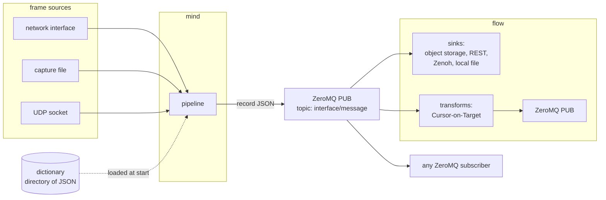

# Architecture

first-bite turns frames on a wire into decoded records on a bus. It reads
frames from a network interface or a capture file, decodes the payload of each
against a dictionary, and publishes one JSON record per packet to ZeroMQ, from
where sinks forward records to object storage, REST endpoints, a Zenoh fabric
or a file.

## Crates

| Crate | Kind | Does |
|---|---|---|
| [`bite`](../bite) | library and `bite` CLI | loads and validates a dictionary; decodes a payload into typed fields; exports JSON Schema. Knows nothing about networks. |
| [`bite-wasm`](../bite-wasm) | WebAssembly module | the `bite` library for browsers: a dictionary from files in memory, decoding, JSON Schema and vectors, called from JavaScript |
| [`mind`](../mind) | binary `mind` | reads frames from a source, finds the transport payload, asks `bite` to decode it, publishes the record |
| [`flow`](../flow) | library | ZeroMQ publishers, and subscribers that forward records to sinks or through transforms |
| [`cotify`](../cotify) | library | builds Cursor-on-Target XML from a decoded record and a field mapping |
| [`datamodels`](../datamodels) | library | the record type that crosses crate boundaries |
| [`logger`](../logger) | library | log line format |

## The dictionary is data

Nothing about a message set is compiled in. A dictionary is a directory of JSON
files that names interfaces, the messages of each, and the bit range, type and
value labels of every field; [dictionary-format.md](dictionary-format.md) is the
reference. `mind` loads the directory named by `--dictionary` or
`BITE_DICT_PATH` once at start into an immutable, indexed structure.

A dictionary for a message set that cannot be published lives outside this
repository and is used the same way. `bite check <dir>` validates it and runs
the test vectors it carries, so a private dictionary is tested by the public
decoder without its contents entering this tree.

## From frame to record

1. **Source.** `mind/src/source.rs` defines `FrameSource`, with three
   implementations: `LiveCapture` (libpcap on an interface, promiscuous, with an
   optional BPF filter), `FileCapture` (a pcap or pcapng file, read once) and
   `UdpFrames` (one Ethernet frame per UDP datagram, for running without capture
   privileges). A frame is a timestamp, a link type and borrowed bytes.
2. **Pipeline.** `mind/src/pipeline.rs` slices the frame with `etherparse`,
   keeps UDP and TCP packets, and looks up the interface by port
   (`Dictionary::interface_for_ports`, source port first). The interface reads
   the message type from the payload and decodes every field of that message.
3. **Record.** Every UDP or TCP packet yields one `PacketInfoWithParsedMessage`
   (`datamodels/src/packets.rs`): timestamp, addresses, ports, the payload and
   the whole frame in base64, deployment metadata from `DATA_SOURCE_*`
   environment variables, and, when the port belongs to an interface, the
   interface name (`subsystem`), the message name (`message_type`) and the
   decoded fields (`message`). A packet on a port no interface claims is still
   published, undecoded.
4. **Publish.** `flow` sends the record on each configured ZeroMQ PUB socket
   under a topic derived from the record, by default `interface/message`.

Field values in `message` are strings: the dictionary's label where the raw
value has one, the value in decimal otherwise, `null` for a field beyond the end
of a short payload. `bite` also produces the typed form (integers as numbers)
and a JSON Schema for it: `bite schema <dir>`.

## Sinks and transforms

A subscriber is a ZeroMQ SUB socket with a topic filter and a sink. Subscribers
are listed in the YAML file named by `SUBSCRIBER_CONFIG_PATH`; with no file
there are none, and records are available only on the PUB socket. Each sink is
a cargo feature of `flow`, forwarded by `mind`.

| Sink | `subscriber_type` | Feature | Status |
|---|---|---|---|
| Azure Blob Storage | `objectstorage` / `azureobject` | `azure` (default) | built |
| S3-compatible storage | `objectstorage` / `awsobject` | `aws` (default) | built |
| HTTP POST | `rest` | always | built |
| local file | `local` | always | built |
| Zenoh | `zenoh` | `zenoh` | built |

A subpub is a subscriber, a transform and a publisher: it reads records, turns
each into something else, and publishes the result on another ZeroMQ socket.
The one transform is Cursor-on-Target (`subtype: cot`), driven by a mapping in
the configuration that says which fields give the identifier, the type and the
position. Subpubs run when `mind` is started with `--activate-subpubs`.

## Beyond IP

`bite` decodes a payload and, optionally, a frame identifier; it does not care
where they came from. The `vehicle-can` dictionary identifies messages by CAN
identifier and reads little-endian signals in `lsb0` bit numbering, and its
vectors pass. What exists for non-IP links today is the decoder and the `bite
decode --frame-id` command.

| Piece | Status |
|---|---|
| decode CAN-style frames: `frame_id` discriminator, `lsb0` numbering | built |
| a `FrameSource` for SocketCAN, and a record shape for frames with no IP addresses | designed, not built |
| importing a DBC file as a dictionary | not built |
| MIL-STD-1553 and ARINC 429 sources | not built |

## In the browser

The library half of `bite` has no dependency on a filesystem or a network:
`Dictionary::from_files` builds a dictionary from file paths and text held in
memory, and gives the same dictionary and the same issues as
`Dictionary::load` gives for a directory with those files.
[`bite-wasm`](../bite-wasm) compiles it for `wasm32-unknown-unknown` and gives
it a JavaScript interface. `make wasm` writes the module to `site/pkg/`, and
[`site/decoder/`](../site/decoder) is a static page that uses it: it loads the
three example dictionaries or a folder the visitor chooses, decodes a payload,
and draws the payload bit by bit with the bits of each field marked. Nothing is
sent anywhere; the page needs only a static file server.

| Piece | Status |
|---|---|
| build a dictionary from files in memory (`Dictionary::from_files`) | built |
| decoder as a WebAssembly module with a JavaScript interface (`bite-wasm`) | built |
| decoder page: bit-level view of a payload, visitor's own dictionary (`site/decoder/`) | built |
| publishing the page with the documentation site | not built |

## Performance

`bite` decodes about 1.7 million messages per second on one core (measured:
331,600 messages averaging 28 fields in 194 ms, release build, x86-64). The
pipeline makes one pass per packet: slice headers, one hash
lookup for the interface, one for the message, one bit extraction per field,
one JSON serialisation.
