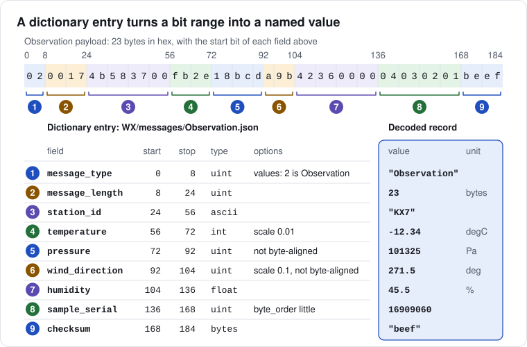

# Dictionary format

A dictionary tells `bite` how to decode the messages of one or more
interfaces. It is a directory of JSON files; nothing about a message set is
compiled into the decoder. `bite check <dir>` validates a dictionary and runs
its test vectors. Writing one from an interface control document is covered
by [icd-to-dictionary](icd-to-dictionary/README.md).

<picture>
  <source media="(prefers-color-scheme: dark)" srcset="img/frame-to-record-dark.svg">
  
</picture>

Four dictionaries ship in [`dictionaries/`](../dictionaries):

| Dictionary | What it is for |
|---|---|
| [`ntp`](../dictionaries/ntp/README.md) | real traffic you already have: the Network Time Protocol header of RFC 5905 on UDP port 123, to capture on your own network. Messages identified by three bits of the first byte, exact fixed-point scaling, an identifier named and not defined |
| `weather-station` | every field type: UDP messages identified by a payload field, with signed, scaled, float, boolean, text, little-endian and non-byte-aligned fields. The one to start a dictionary from |
| `vehicle-can` | the frame identifier as discriminator: CAN frames with little-endian signals in `lsb0` numbering |
| `glasshouse` | transcribed from a document: two interfaces from a synthetic interface document, with a source for every field, a declared length for every message and a vector for each. The [worked example](icd-to-dictionary/06-worked-example/README.md) |

## Layout

```text
<dictionary>/
  dictionary.json                 optional
  <INTERFACE>/
    metadata.json                 required; makes the directory an interface
    messages/
      <Message Name>.json         one file per message; the file stem is the name
  vectors/
    <any-name>.json               optional test vectors
```

An interface is a set of messages that share a transport and one way of
telling the messages apart: one ICD, one CAN bus, one serial link.

## `dictionary.json`

| Key | Type | Meaning |
|---|---|---|
| `name` | string | dictionary name |
| `version` | string | dictionary version |
| `description` | string | free text |
| `source` | object | the document the dictionary was transcribed from, see [Keys for authoring](#keys-for-authoring) |
| `lint` | object | units added to the vocabulary and findings allowed with a reason, see [Keys for authoring](#keys-for-authoring) |

## `metadata.json`

| Key | Type | Default | Meaning |
|---|---|---|---|
| `message_type` | object | required | how a message is identified, see below |
| `port` | integer | none | UDP or TCP port. A packet whose source or destination port equals it belongs to this interface; the source port is tried first. Two interfaces may not claim one port. |
| `bit_order` | `"msb0"` or `"lsb0"` | `"msb0"` | how bit positions are numbered, see [Bit numbering](#bit-numbering) |
| `byte_order` | `"big"` or `"little"` | `"big"` | byte order of byte-aligned fields under `msb0` |
| `message_length` | `{start, stop}` | none | where a message states its own length |
| `description` (or `mission`) | string | none | free text |
| `icd` | `{version, date}` | none | the document the interface was transcribed from |
| `protocol` | `{network, transport}` | none | informational |
| `source` | object | none | where the interface is defined in the document |
| `note` | string | none | a remark for the next maintainer |
| `icd_numbering` | object | none | how the document numbers words and bits, see [Keys for authoring](#keys-for-authoring) |

### `message_type`

| Key | Type | Default | Meaning |
|---|---|---|---|
| `source` | `"payload"` or `"frame_id"` | `"payload"` | `payload`: the identifier is bits `[start, stop)` of the payload. `frame_id`: it is the identifier that arrives with the frame, such as a CAN identifier. |
| `start`, `stop` | integer | `0` | bit range, for `payload`; 1 to 64 bits |
| `mask` | string | none | for `frame_id`: ANDed with the identifier before lookup |
| `values` | object | `{}` | identifier to message name |

An identifier with no entry in `values` decodes to a record whose message type
is the identifier in decimal and which has no fields. A name in `values` with no
file in `messages/` is identified but not decoded; `bite check` warns about it.

## `messages/<Message Name>.json`

| Key | Type | Meaning |
|---|---|---|
| `description` | string | free text |
| `fields` | object | field name to field definition |
| `declared_bits` | integer | the length the document gives the message, in bits; `bite coverage` measures gaps against it |
| `source` | object | where the message is defined in the document |
| `note` | string | a remark for the next maintainer |

### Field

| Key | Type | Default | Meaning |
|---|---|---|---|
| `start`, `stop` | integer | required | bit range `[start, stop)` |
| `type` | string | `"uint"` | `uint`, `int`, `float`, `bool`, `bytes`, `ascii` |
| `signed` | boolean | `false` | `true` is shorthand for `"type": "int"` |
| `byte_order` | `"big"` or `"little"` | interface's | overrides the interface byte order |
| `scale`, `offset` | number | `1`, `0` | value is `raw * scale + offset`, as a float. For an integer field the result is rounded to the decimal places `scale` and `offset` are written with, so raw 35 with scale `0.01` is `0.35` and not `0.35000000000000003`. A scale or offset that needs more than 15 decimal places (a power of two such as 2^-32, or 1/3) and a result of more than 15 significant digits are not rounded |
| `values` | object | none | raw integer to label |
| `unit` | string | none | informational |
| `description` | string | none | informational |
| `source` | object | the message's | where the field is defined in the document |
| `note` | string | none | a remark for the next maintainer: an erratum, an encoding the format cannot express |

| Type | Width | Decodes to |
|---|---|---|
| `uint` | 1 to 64 bits, any alignment | unsigned integer |
| `int` | 1 to 64 bits, any alignment | two's-complement integer |
| `float` | 32 or 64 bits | IEEE 754 float |
| `bool` | 1 to 64 bits | `false` when all bits are zero |
| `bytes` | whole bytes, byte-aligned, any length | hex string |
| `ascii` | whole bytes, byte-aligned, any length | text with trailing NUL bytes and spaces removed |

A field with no `type` that is byte-aligned and wider than 64 bits is `bytes`.

Keys in `values` (fields and `message_type`) are integers written as strings,
in decimal or `0x` hexadecimal; field value keys may be negative. Labels are
looked up on the raw integer, before `scale` and `offset`.

A field that reaches past the end of the payload decodes to `null`. The other
fields of the message still decode.

## Bit numbering

`msb0` is the numbering protocol documents use: bit 0 is the most significant
bit of byte 0, and a field is read as a big-endian bit string. A field of bits
`[12, 20)` is the low four bits of byte 1 followed by the high four bits of
byte 2. With `"byte_order": "little"` a byte-aligned field has its bytes
reversed; a little-endian field must be byte-aligned.

`lsb0` is the numbering of little-endian ("Intel") signals on CAN: bit 0 is the
least significant bit of byte 0, and the payload is read as one little-endian
integer. A field of bits `[12, 20)` is the high four bits of byte 1 (its low
half) and the low four bits of byte 2 (its high half).

## Test vectors

Each file in `vectors/` is a payload and what it must decode to:

```json
{
    "interface": "WX",
    "payload_hex": "01000c4b58370000015180600000",
    "expect": {
        "message_type": "Heartbeat",
        "fields": {
            "station_id": "KX7",
            "uptime": "86400",
            "mode": "Calibrating"
        }
    }
}
```

| Key | Meaning |
|---|---|
| `interface` | interface name |
| `payload_hex` | payload bytes; whitespace ignored |
| `frame_id` | frame identifier, for `frame_id` interfaces |
| `expect.message_type` | expected message name |
| `expect.fields` | field name to expected value as text: the label where the field has one, the value otherwise, `null` for a field beyond the payload. Fields not listed are not checked. |
| `source`, `note` | where the expected values come from |

An expected value is compared as text, except for a field that decodes to a
float (type `float`, or any field with `scale` or `offset`): there the two are
compared as numbers to nine significant digits, so a vector can say `21.0`
where the decoder writes `21`, and `0.666666667` for a field whose scale is
not a decimal, where the decoder computes `0.6666666666666666`.

## Keys for authoring

The decoder ignores these keys; a dictionary without them decodes the same.
They are read by `bite coverage`, `bite lint`, `bite diff`, `bite range` and
the CSV commands, and
[the conventions](icd-to-dictionary/02-conventions.md) say when each is
required.

### `source`

Where a definition was transcribed from. Allowed in `dictionary.json`,
`metadata.json`, a message, a field and a vector. A member that is absent is
taken from the level above: a field from its message, a message from its
interface, an interface from the dictionary.

| Key | Meaning |
|---|---|
| `document` | the document's identifier |
| `revision` | its revision |
| `section` | section number |
| `table` | table number |
| `page` | page number |

Each member is text; a number is accepted and written as text by `bite fmt`.
A source is complete when it resolves a `document`, a `revision` and at least
one of `section`, `table` and `page`.

### `icd_numbering`

In `metadata.json`: how the document addresses bits, so that `bite range`,
`bite import-csv` and `bite export-csv` can convert between its "word 3,
bits 12-5" and `[start, stop)`.

| Key | Type | Default | Meaning |
|---|---|---|---|
| `word_bits` | integer | required | word size in bits, 1 to 64 |
| `bit0` | `"msb"` or `"lsb"` | required | which end of a word the document numbers first |
| `first_word` | `0` or `1` | required | the number of the first word |
| `first_bit` | `0` or `1` | `0` | the number of the first bit of a word |
| `word_order` | `"big"` or `"little"` | `"big"` | `big`: a word is sent most significant byte first, and ranges are under `"bit_order": "msb0"`. `little`: least significant byte first, and ranges are under `"bit_order": "lsb0"`. |

### `lint`

In `dictionary.json`.

| Key | Type | Meaning |
|---|---|---|
| `units` | list of strings | units accepted in addition to the [unit vocabulary](icd-to-dictionary/02-conventions.md#units) |
| `allow` | list of objects | findings that are accepted, each with a reason |

An entry of `allow`:

| Key | Meaning |
|---|---|
| `rule` | the rule's identifier, such as `C004` |
| `at` | the location the entry covers, with everything under it: `ZONE`, `ZONE/Alarm` or `ZONE/Alarm/severity`. Everywhere when absent. |
| `reason` | why the finding is accepted; required |

`bite lint` and `bite coverage` leave an allowed finding out of their failures
and report an entry that matches nothing. `bite check --strict` honours an
entry for the three warnings that have a rule: overlapping fields (`C002`), a
message named and not defined (`C004`), a message defined and not named
(`C005`).

## Limits

A dictionary may come from someone else, and in the browser decoder from any
file a visitor is handed. The loader bounds what one can cost in memory and
time. Each limit is a constant in `bite/src/limits.rs`.

| Limit | Value | Constant | Over the limit |
|---|---|---|---|
| size of one dictionary file | 4 MiB (4,194,304 bytes) | `MAX_FILE_BYTES` | error; the file is not read |
| files in one dictionary: `dictionary.json`, every `metadata.json`, message and vector together | 10,000 | `MAX_FILES` | the dictionary does not load |
| fields in one message | 4,096 | `MAX_FIELDS_PER_MESSAGE` | error; the message is left out |
| entries in one `values` object (labels of a field, names of `message_type`) | 65,536 | `MAX_VALUES` | error; the field is left out, or the interface identifies no message |
| payload length considered | 65,535 bytes (bit 524,280) | `MAX_PAYLOAD_BYTES` | error; a field or `message_type` range whose `stop` is past it is left out |

65,535 bytes is the largest UDP datagram or TCP segment, so no field of a
captured packet lies beyond it. Because no loaded field reaches further,
decoding reads at most that many bytes of a payload however long it is.

JSON nested more than 128 levels deep is refused by the parser as not valid
JSON. A key or label quoted in a finding is cut to 80 characters.

## What `bite check` reports

| Severity | Finding | Effect on loading |
|---|---|---|
| error | file is not valid JSON or lacks a required key | file left out |
| error | field range empty or inverted; integer wider than 64 bits; float not 32 or 64 bits; `bytes`/`ascii` not byte-aligned; little-endian field not byte-aligned under `msb0` | field left out |
| error | `message_type` range not 1 to 64 bits; a `values` key or `mask` that is not an integer (decimal or `0x` hexadecimal, at most one sign) | value left out |
| error | two interfaces claim one port | the first, by name, keeps it |
| error | a file, message, `values` object or bit range over a [limit](#limits) | as the limits table says |
| warning | fields overlap | both kept |
| warning | message file that no `message_type` value names | kept, never selected |
| warning | `message_type` value with no message file | identified, not decoded |
| warning | label that is not text, or a label on a `float`, `bytes` or `ascii` field | label ignored |

`bite check` exits non-zero on any error or failed vector; `--strict` also
fails on warnings that `lint.allow` does not cover.

The loader reads each file with the last of two equal keys winning, so a field
name written twice in one message loses a field without a warning.
`bite fmt` refuses such a file. `bite coverage` reports the bits no field
covers, and `bite lint` the conventions; see
[bite/README.md](../bite/README.md) for every command.
