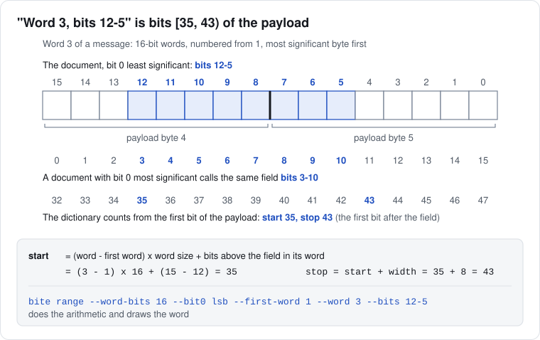

# Reading an ICD

An interface document answers six questions for each interface, and it rarely
answers them in one place. This page lists the questions, where documents tend
to put the answers, and how each answer is written in a dictionary. The key
names are those of [the dictionary format](../dictionary-format.md).

## What to extract

| Question | Where documents put it | Goes in |
|---|---|---|
| What carries the messages? | a "transport", "physical interface" or "communications" section; sometimes a separate network document | `metadata.json`: `protocol`, `port` |
| How is a message told from another? | the header definition; a "message summary" table of identifiers and names | `metadata.json`: `message_type` |
| Which messages exist? | the summary table; the table of contents; an appendix of "reserved" or "future" messages | `message_type.values`, one entry per name, defined or not |
| What do all messages share? | a "common header" section, defined once and referred to by every message | repeated in every message file |
| How are words and bits numbered? | a "conventions" or "data representation" section near the front; a figure of one word; sometimes only the tables themselves | `metadata.json`: `bit_order`, `byte_order`, `icd_numbering` |
| What does each field mean? | one table per message: field, word, bits, type, LSB weight, units, description | `messages/<name>.json` |

Read the conventions section first and the appendices second. Appendices hold
the example messages that become [vectors](04-vectors-and-validation.md), and
the revision history that says which tables changed.

### Transport and port

`port` is the UDP or TCP port that marks a packet as belonging to the
interface: the decoder matches it against the packet's source port, then its
destination port. Where each direction of a link has its own message set, make
each direction an interface with its own port, as the
[worked example](06-worked-example/README.md) does with `ZONE` and `SUPV`.

### How messages are identified

| The document says | `message_type` |
|---|---|
| "the message identifier is bits 15-8 of word 1" | `"start": 0, "stop": 8` and the names under `values` |
| a type and a subtype in adjacent bits | one range covering both; each key in `values` is the combined number |
| "identified by the CAN identifier" or by a bus sub-address | `"source": "frame_id"`, with a `mask` if only some bits identify the message |
| a type and a subtype in bits that are not adjacent | not built; see [what the format cannot express](#what-the-format-cannot-express) |

Enter every name the summary table gives, including messages you will not
define. A named message with no definition is identified and not decoded, and
`bite coverage` lists it, which is how the gap between what the document names
and what the dictionary defines stays visible.

### Header fields

The format has no shared header: each message file repeats the header fields.
Give them the same names in every message of an interface; rule `H001`
checks that the fields on the `message_type` and `message_length` bits are
present and named alike. In `fields.csv` the header is the same rows repeated
under each message.

### Length

A message's length goes in two places. `message_length` in `metadata.json` is
where the message states its own length, if it does. `declared_bits` in each
message file is the length the document gives that message, converted to bits.
`bite coverage` reports every bit below `declared_bits` that no field covers.

Check what the length field counts (bytes or words) and whether it includes
the header. Documents often leave this to an example.

## Bit numbering

A dictionary addresses a field by a half-open range `[start, stop)` counted
from the first bit of the payload. A document addresses it by word and bit.
Five facts about the document decide the conversion, and getting one wrong
moves every field.

<picture>
  <source media="(prefers-color-scheme: dark)" srcset="../img/bit-numbering-dark.svg">
  
</picture>

| Fact | Find it by | `icd_numbering` key |
|---|---|---|
| Word size | the conventions section; the highest bit number in any table | `word_bits` |
| Which end of a word is bit 0 | the figure of a word; a field described as "sign bit" or "MSB" and its bit number | `bit0`: `msb` or `lsb` |
| Whether the first word is 0 or 1 | the header table: the number of its first word | `first_word` |
| Whether the first bit is 0 or 1 | the highest bit number: 15 means from 0, 16 means from 1 | `first_bit` |
| The order a word's bytes are sent in | "big-endian", "network order", "MSB first"; or "little-endian", "Intel" | `word_order`: `big` or `little` |

`bite range` converts in either direction and draws the word, so that the
picture can be held against the document's own figure:

```console
$ bite range --word-bits 16 --word 3 --bits 12-5 --bit0 lsb --first-word 1
start 35
stop  43
width 8 bits, under "bit_order": "msb0"
numbering: 16-bit words numbered from 1, sent most significant byte first; bit 0 is the least significant bit of a word
word 3 (payload bytes 4-5)
  15 14 13 12 11 10  9  8  7  6  5  4  3  2  1  0
   .  .  .  #  #  #  #  #  #  #  #  .  .  .  .  .
```

```console
$ bite range --word-bits 8 --bit0 lsb --first-word 0 --start 82 --stop 84
word 10
bits 5-4
width 2 bits, under "bit_order": "msb0"
numbering: 8-bit words numbered from 0, sent most significant byte first; bit 0 is the least significant bit of a word
word 10 (payload byte 10)
  7 6 5 4 3 2 1 0
  . . # # . . . .
```

### Worked conversions

Each row was worked by hand and is a case of the test `hand_worked_table` in
[`bite/src/authoring/range.rs`](../../bite/src/authoring/range.rs).

| The document says | Word size | Bit 0 | First word | First bit | `[start, stop)` | Why |
|---|---|---|---|---|---|---|
| word 3, bits 12-5 | 16 | LSB | 1 | 0 | `[35, 43)` | two words before it, 32 bits; bit 12 is 3 from the top |
| word 2, bits 12-5 | 16 | LSB | 0 | 0 | `[35, 43)` | the same word, counted from 0 |
| word 3, bits 3-10 | 16 | MSB | 1 | 0 | `[35, 43)` | bit numbers are already offsets from the top |
| word 3, bits 4-11 | 16 | MSB | 1 | 1 | `[35, 43)` | as above, with bits counted from 1 |
| word 3, bits 13-6 | 16 | LSB | 1 | 1 | `[35, 43)` | bits run 16 down to 1 |
| byte 10, bits 5-4 | 8 | LSB | 0 | 0 | `[82, 84)` | ten bytes before it, 80 bits; bit 5 is 2 from the top |
| word 1, bits 31-28 | 32 | LSB | 0 | 0 | `[32, 36)` | one 32-bit word before it |
| word 1, bit 0 | 16 | LSB | 1 | 0 | `[15, 16)` | the last bit of the first word |

Under `msb0`, with words sent most significant byte first:

- `start` = (word - first word) x word size + the number of bits above the field in its word;
- `stop` = `start` + the field's width.

### Fields that cross words

Documents write a field that spans words in several ways: "word 5 and word 6
bits 15-8", "words 5-6", a row per word with "MSW" and "LSW". Enter it as one
field: the range of words, the field's first bit in the first word and its
last bit in the last word.

| The document says | `word` | `bits` | `[start, stop)` | Width |
|---|---|---|---|---|
| words 3 and 4, all of both | `3-4` | `15-0` | `[32, 64)` | 32 |
| word 7, and word 8 bits 15-8 | `7-8` | `15-8` | `[96, 120)` | 24 |
| word 6 bits 7-0, and word 7 | `6-7` | `7-0` | `[88, 112)` | 24 |
| word 4 bits 3-0, and word 5 bits 15-4 | `4-5` | `3-4` | `[60, 76)` | 16 |

This holds when the most significant part comes first, which is what a
big-endian document means by a field crossing words. If the document puts the
least significant word first while each word is big-endian, the field is not
one contiguous range: see
[what the format cannot express](#what-the-format-cannot-express).

### Little-endian words

When each word is sent least significant byte first, set
`"bit_order": "lsb0"` on the interface and `"word_order": "little"` in
`icd_numbering`. Bit 0 of the dictionary is then the least significant bit of
the first byte, and a field's bits are counted from the low end:

```console
$ bite range --word-bits 16 --bit0 lsb --first-word 1 --word-order little --word 3 --bits 12-5
start 37
stop  45
width 8 bits, under "bit_order": "lsb0"
numbering: 16-bit words numbered from 1, sent least significant byte first; bit 0 is the least significant bit of a word
word 3 (payload bytes 4-5)
  15 14 13 12 11 10  9  8  7  6  5  4  3  2  1  0
   .  .  .  #  #  #  #  #  #  #  #  .  .  .  .  .
(each word is drawn most significant bit first; its low byte is sent first)
```

A field that crosses little-endian words has its low part in the first word.
One interface has one `bit_order`. A big-endian message with a single
byte-aligned little-endian field keeps `msb0` and gives that field
`"byte_order": "little"`.

### Test the numbering before transcribing

Pick one field whose value you know in an example message from the document,
convert it with `bite range`, and read those bits out of the example by hand.
Do it for a field in the first word and for one in a later word: an error in
`first_word` shows only in the second.

## Signed encodings

| The document says | Meaning | In the dictionary |
|---|---|---|
| two's complement, "2C", "signed" | the usual signed integer | `"type": "int"` |
| offset binary, "excess-N", "biased" | the unsigned integer minus a constant, usually half the range | unsigned, with `"offset"` equal to minus the constant times the LSB weight. A 12-bit field with LSB 0.05 that reads zero at 2048: `"scale": 0.05, "offset": -102.4` |
| sign-magnitude, "sign and magnitude", "SM" | a sign bit and an unsigned magnitude | not built. Two fields, `<name>_sign` with the labels `Positive` and `Negative`, and `<name>_magnitude` with the scale and unit; a `note` on each says so |
| one's complement | negative values are the bitwise inverse | not built. An unsigned field with a `note`; the consumer converts |
| binary-coded decimal, "BCD" | four bits per decimal digit | not built. One 4-bit field per digit, `<name>_digit_<n>` from the most significant, or one `bytes` field, with a `note` |

A sign-magnitude field read as two's complement is right for every positive
value and wrong for every negative one, so it passes a test made only of
positive examples. Use a negative example for every signed field.

## Scaling and units

The decoder computes `raw x scale + offset`.

| The document gives | `scale` |
|---|---|
| an LSB weight ("LSB = 0.01 degC") | that weight |
| an MSB weight ("MSB = 180 deg", a binary angle) | MSB weight / 2^(n-1) for an unsigned field of n bits; for a two's-complement field the sign bit carries the stated weight, negative |
| a range ("0 to 100 % over 10 bits") | range / (2^n - 1) if the top value is the top of the range, range / 2^n if it is one step short; the document's example decides |
| a resolution in a different unit from the one you record | convert once, exactly, and record the unit you converted to |

Write the weight as the document does: `0.01`, not `1e-2`. Leave `scale` out
when the weight is 1. Units come from a
[short vocabulary](02-conventions.md#units): `degC` for the document's "°C",
`m/s2` for "m/s²". A count, an index or an identifier takes the unit `1`.

## Enumerations, discretes, spares

| The document gives | In the dictionary |
|---|---|
| a value and a meaning | one entry of `values`, the label being the document's wording |
| a value marked reserved, spare or undefined | nothing: an unlabelled value decodes to its number, which is what a reserved value should look like to a consumer |
| a range of values with one meaning ("200-255 manufacturer specific") | no labels; a `note` on the field states the range |
| one bit that is set or not set ("discrete") | `"type": "bool"` |
| one bit with two named states ("0 = Closed, 1 = Open") | an unsigned 1-bit field with two labels |
| spare or reserved bits | a field named `spare_<start bit>` or `reserved_<start bit>`, so that the bits are accounted for and `bite stats` can report a payload that sets them |

## What the format cannot express

A dictionary describes fixed layouts: every field of a message is at the same
bits in every payload. The structures below are not built. For each, the table
gives what to transcribe meanwhile; in every case the field or message carries
a `note` saying what was left out, so that the gap can be found again.

| Structure in the document | Status | Meanwhile |
|---|---|---|
| A repeated group with a count ("N records follow") | not built | Transcribe the fixed part and set `declared_bits` to its length. If the largest N is small, add one set of fields per repetition, `<group>_<n>_<field>`: fields past the end of a shorter payload decode to `null`. |
| A field whose meaning depends on another field | not built | One field per interpretation over the same bits, with the overlap allowed under `C002` and the reason given; the consumer chooses by the other field. |
| A message type selected by two fields that are not adjacent | not built | Identify by the first; define the fields common to every subtype. |
| A variable-length field (a counted string) | not built | The fixed part only. |
| A field in two non-adjacent pieces, or least significant word first in a big-endian message | not built | `<name>_high` and `<name>_low`; the consumer joins them. |
| Sign-magnitude, one's complement, BCD | not built | See [signed encodings](#signed-encodings). |
| A scale that depends on another field | not built | The raw integer, without `scale`. |
| A checksum or CRC | decoded as a value, not verified | A field; verification is the consumer's. |
| Several messages in one datagram; a message across datagrams | not built | The decoder reads one message from the first bit of each payload. |
| An integer wider than 64 bits | `bytes` if byte-aligned | Otherwise two fields. |

`bite stats` flags a payload longer than the message's `declared_bits`, which
is what a repeated group looks like in a capture.
