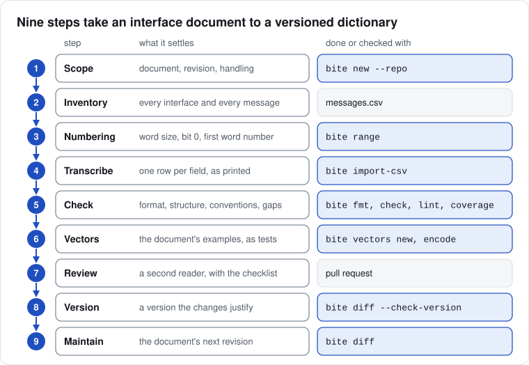
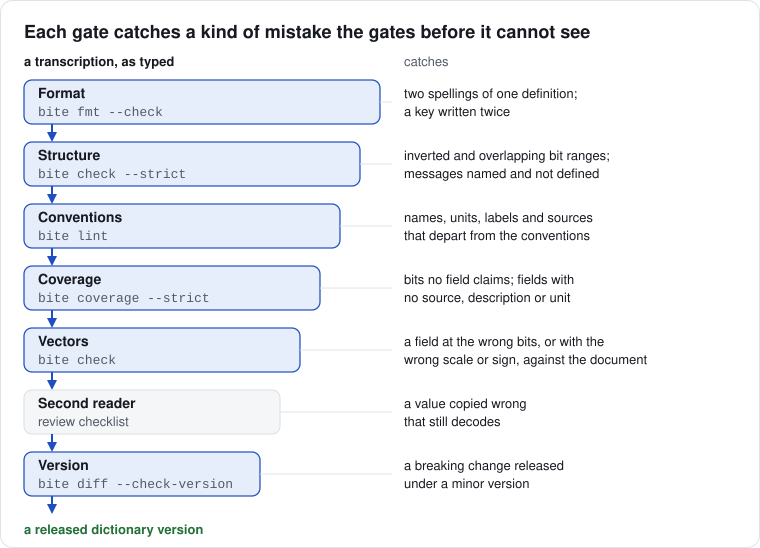

# From an interface document to a dictionary

An interface control document (ICD) defines the messages two systems exchange,
usually as hundreds of pages of word-and-bit tables. A first-bite dictionary
holds the same definitions as JSON the decoder loads. This guide is the way
from one to the other: what to read out of the document, the conventions that
make two people's transcriptions come out the same, the `bite` commands that
catch mistakes, and how to keep the dictionary right when the document is
revised.

<picture>
  <source media="(prefers-color-scheme: dark)" srcset="../img/icd-pipeline-dark.svg">
  
</picture>

## The path

| Step | What you do | Command | Page |
|---|---|---|---|
| 1. Scope | Fix the document, its revision and the interfaces to transcribe. Read its distribution statement; the dictionary inherits it. Start the repository. | `bite new <dir> --repo` | [conventions](02-conventions.md#handling) |
| 2. Inventory | List every interface and every message the document names, with its identifier, whether or not you will define it. | `messages.csv` | [reading an ICD](01-reading-an-icd.md#what-to-extract) |
| 3. Numbering | Establish the word size, which end of a word is bit 0, and whether words count from 0 or 1. Test it on a field whose value you know. | `bite range` | [reading an ICD](01-reading-an-icd.md#bit-numbering) |
| 4. Transcribe | Enter one row per field, with the word and bits exactly as printed. | `bite import-csv` | [workflow](03-transcription-workflow.md) |
| 5. Check | Run the four gates until they pass. | `bite fmt`, `bite check --strict`, `bite lint`, `bite coverage --strict` | [workflow](03-transcription-workflow.md#the-gates) |
| 6. Vectors | Turn the document's example messages into test vectors, one per message at least. | `bite vectors new`, `bite vectors encode` | [vectors](04-vectors-and-validation.md) |
| 7. Review | A second person reads every field against the document. | pull request | [checklists](checklists.md#review) |
| 8. Version | Give the dictionary a version the changes justify. | `bite diff --check-version` | [conventions](02-conventions.md#versions) |
| 9. Maintain | When the document is revised, transcribe the changes and compare. | `bite diff` | [maintaining](05-maintaining.md) |

The [worked example](06-worked-example/README.md) goes through all nine on a
synthetic 12-page document, and
[`retrace.sh`](06-worked-example/retrace.sh) runs it end to end and compares
the result with [`dictionaries/glasshouse`](../../dictionaries/glasshouse)
byte for byte.

## Pages

| Page | Covers |
|---|---|
| [01 Reading an ICD](01-reading-an-icd.md) | what to extract and where documents put it; bit numbering with worked conversions; signed encodings; scaling; enumerations; what the format cannot express |
| [02 Conventions](02-conventions.md) | names, units, labels, descriptions, sources, versions, repository layout, handling; every `bite lint` and `bite coverage` rule |
| [03 Transcription workflow](03-transcription-workflow.md) | the working loop; the four CSV tables column by column; errata and ambiguities |
| [04 Vectors and validation](04-vectors-and-validation.md) | where expected values come from; building payloads; what a capture can and cannot tell you |
| [05 Maintaining](05-maintaining.md) | a new revision of the document; `bite diff`; deprecation; the changelog |
| [06 Worked example](06-worked-example/README.md) | a synthetic document, its tables, the dictionary and the output of every step |
| [Checklists](checklists.md) | transcription, review, release |

## What catches what

<picture>
  <source media="(prefers-color-scheme: dark)" srcset="../img/quality-gates-dark.svg">
  
</picture>

| Mistake | Caught by |
|---|---|
| The same definition written two ways; a field name used twice in a message | `bite fmt --check` |
| A bit range with stop before start; a field wider than its type allows | `bite check` (error) |
| Two fields sharing bits; a message named and not defined | `bite check --strict` |
| Bits that belong to no field; a field past the message's stated length | `bite coverage --strict` |
| A field with no source, description or unit; a message with no vector | `bite coverage --strict` |
| A name, unit or label off the conventions; a label on a reserved value | `bite lint` |
| The word and bits typed for a field disagreeing with its start and stop | `bite import-csv` |
| A field at the wrong bits, or with the wrong scale, sign or byte order | a vector from the document's examples, run by `bite check` |
| A payload in the document that the field values do not account for | `bite vectors encode --vector` |
| A value copied wrong that still decodes to something plausible | the second reader |
| A field that never changes, or values outside an enumeration, in real traffic | `bite stats` |
| A change that breaks consumers, released as a minor version | `bite diff --check-version` |

## Status

| Part | Status |
|---|---|
| `bite new`, `range`, `import-csv`, `export-csv`, `fmt`, `coverage`, `lint`, `diff`, `vectors new`, `vectors encode`, `stats` | built; tests in [`bite/tests/authoring.rs`](../../bite/tests/authoring.rs) and [`bite/tests/cli.rs`](../../bite/tests/cli.rs) |
| Worked example | measured: [`retrace.out`](06-worked-example/retrace.out) is the output of `retrace.sh` |
| Repository template, [`tools/dictionary-repo-template`](../../tools/dictionary-repo-template) | built; its workflow has not run on GitHub, because no first-bite release carries these commands yet |
| PDF table extraction, [`tools/icd-extract`](../../tools/icd-extract) | built for tables laid out like the worked example's; measured on its PDF |
| Repeated groups, conditional layouts, sign-magnitude and BCD fields in the dictionary format | not built; [what to do meanwhile](01-reading-an-icd.md#what-the-format-cannot-express) |
