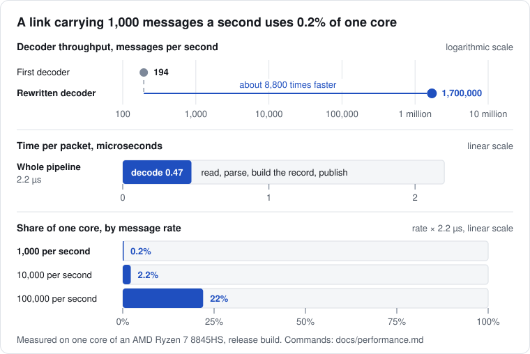

# Performance

Every figure here was measured by a command in this repository, on one core of
an AMD Ryzen 7 8845HS (a 2024 laptop-class processor) under Linux, with a
release build. The decode and pipeline figures are from 2026-11-15 on the
code of release 1.1.0, publishing version 2 JSON records, with the machine
also running other work (load average about 11). Run the same commands to get
the figures for your hardware.

<picture>
  <source media="(prefers-color-scheme: dark)" srcset="img/performance-dark.svg">
  
</picture>

| What | Result | Command |
|---|---|---|
| Decode one message (identify it, extract every field, render the values) | **0.47 µs**: 2.1 million messages, 13.6 million fields per second | `cargo run --release -p bite --example throughput -- dictionaries/weather-station` |
| The same on CAN-style frames | 0.55 µs: 1.8 million frames per second (one run, load average about 21) | `… -- dictionaries/vehicle-can` |
| Whole pipeline: read a frame, parse Ethernet/IP/UDP, decode, build the record, publish it as JSON on ZeroMQ | **2.2 µs**: 450,000 packets per second, the median of seven runs (421,487 to 466,798) | `mind --pcap-file load.pcap --dictionary dictionaries/weather-station` on 2,000,000 packets |
| The same, also writing one log line per record | 164,000 packets per second | as above with `RUST_LOG=warn,mind=info` |
| Memory while replaying a 145 MB capture | 10.9 MB resident | `/usr/bin/time -f %M` on the same run |
| Live capture on two interfaces at once | 500 of 500 packets decoded, none dropped | `mind lo eno1 --filter "udp port 40100"` |
| `mind`, plain release build | 14.04 MB (14,040,000 bytes, to the nearest 10,000) | `make release` |
| `mind`, portable build: one file that needs only glibc | 14.67 MB (14,673,768 bytes) | `make portable` (`tools/build-portable.sh` in Ubuntu 20.04) |

The seven pipeline runs gave 448,058, 464,851, 459,722, 450,101, 466,798,
423,295 and 421,487 frames per second; the median is 450,101, and
1,000,000 µs / 450,101 = 2.2 µs per packet. Decoding takes 471 ns per message:
1,000,000,000 / 471 = 2.1 million messages per second.

The load file is the five weather-station vectors repeated:

```bash
tools/make-example-pcap.py dictionaries/weather-station load.pcap --repeat 400000
RUST_LOG=warn,mind=info,mind::run=warn \
    target/release/mind --pcap-file load.pcap --dictionary dictionaries/weather-station
```

`mind` prints the rate when a replay ends; the median run:

```text
done: 2000000 frames, 2000000 records, 2000000 decoded, 0 not UDP or TCP, 0 malformed
replayed in 4.443 s: 450101 frames per second
```

## What the numbers mean

At 2.2 µs per packet, a link carrying 1,000 messages per second uses about 0.2%
of one core (1,000 × 2.2 µs = 2.2 ms of each second), and a record is on the
bus about two microseconds after its frame is read. The capture runs beside the systems on the link, on a tap or a
mirror port, so none of that time is taken from them.

The pipeline is one thread. The cost per packet is fixed by the work listed in
the table, not by the size of the dictionary: finding the interface is one hash
lookup on the port, finding the message is one more on the message type.

## Record size and encoding

A record leaves as version 2 JSON by default; version 1 JSON and CBOR are
settings ([record.md](record.md)). Measured on the vectors of two example
dictionaries, each wrapped in a UDP frame and passed through the pipeline:

```bash
cargo run --release -p mind --example encodings -- dictionaries/weather-station
```

| Mean bytes per record | Version 1 JSON | Version 2 JSON | Version 2 CBOR |
|---|---|---|---|
| weather-station, 5 vectors: whole record | 724 | 776 | **639** |
| weather-station: `message` alone | 137 | 131 | 104 |
| glasshouse, 10 vectors: whole record | 859 | 892 | **733** |
| glasshouse: `message` alone | 261 | 238 | 192 |

Typed values make `message` 5% to 9% smaller than text values. The whole
version 2 record is 4% to 7% larger than version 1, because it names the
dictionary and its own version (`dictionary`, `dictionary_version`,
`data_model_version`: about 60 bytes). CBOR is 18% smaller than version 2
JSON. In every form most of a record is its field names and the two base64
buffers: of the 648 bytes of a CBOR heartbeat, 121 are the decoded message.

| Time per record, one core, median of five runs | weather-station | glasshouse |
|---|---|---|
| Version 1 record to JSON text | 0.50 µs | 0.62 µs |
| Version 2 record to JSON text | 0.53 µs | 0.68 µs |
| JSON text to CBOR, done once more per record when a publisher or sink has `encoding: cbor` | 1.40 µs | 1.77 µs |
| CBOR back to JSON text, done by a subscriber that reads a CBOR publisher | 1.37 µs | 1.64 µs |

The whole pipeline on the 2,000,000-packet load file, with the publisher set
as shown, median of seven runs each, the runs of the three forms interleaved
(2026-11-15, the machine also running other work at a load average of 10):

| Record published on ZeroMQ | Packets per second | Per packet |
|---|---|---|
| Version 2 JSON (the default) | **449,000** (430,000 to 459,000) | 2.2 µs |
| Version 1 JSON (`FIRST_BITE_RECORD_VERSION=1`) | 406,000 (376,000 to 413,000) | 2.5 µs |
| Version 2 CBOR (`encoding: cbor` on the publisher) | 270,000 (259,000 to 276,000) | 3.7 µs |
| Version 2 JSON, also writing one log line per record | 164,000 | 6.1 µs |

The default `mind` binary has 277 crates in its dependency tree, the same
crates as before CBOR was added: the codec is part of `flow`.

## What changed from the first implementation

The first decoder in this project looked every field up through a string-keyed
map and copied the whole dictionary for each field it decoded. Both decoders
were measured on the same 1,658 recorded messages, averaging 28 fields each,
when the decoder was rewritten. The rewrite decoded them 200 times over,
331,600 messages, in 194 ms: 331,600 / 0.194 s = 1,700,000 per second, and
1,700,000 / 194 = about 8,800 times the first.

| | First implementation | The rewrite |
|---|---|---|
| Messages decoded per second, one core | 194 | 1,700,000 |
| Fields that straddle a byte boundary | returned as null | decoded |
| Dictionary | compiled into the binary | a directory loaded at start |
| Faulty dictionary entries | skipped silently | reported by `bite check` with file and field |

## Not measured

Live capture at high packet rates on a physical tap, where the limits are the
network card, the kernel capture buffer and the sinks rather than the decoder;
`docs/tap.md` describes the loss counters that show when one of them is the
limit. Sink throughput to object storage or a Zenoh router, which depends on
the far end.
