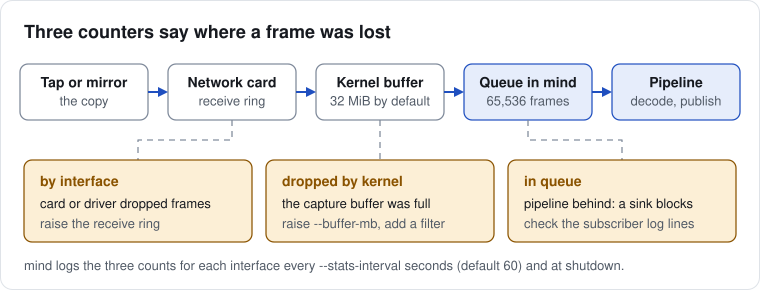

# Running on a tap or a mirror port

first-bite only listens. It opens the capture interface for reading, never
sends on it, and the systems on the tapped link cannot tell it is there: with a
passive tap there is no electrical path from the monitor ports back to the
link, and a decoder that stalls or crashes costs the link nothing.

<picture>
  <source media="(prefers-color-scheme: dark)" srcset="img/tap-placement-dark.svg">
  
</picture>

To check what a port receives before relying on it, `mind lan hub` tells a hub
or mirror port from a switch port, and `mind lan follow` turns one server's TCP
stream into a local stand-in for that server ([lan.md](lan.md)).

## Where the copy comes from

first-bite reads a copy of the traffic. Four ways of making that copy are
supported; which one to use depends on what the network allows.

| | Passive or aggregating tap | Mirror port (SPAN) | Remote mirror in GRE (ERSPAN, GRE-tunnelled mirroring) | Remote mirror in VXLAN |
|---|---|---|---|---|
| What arrives | the frames, as sent | the frames, as sent; a VLAN tag is added by a remote-VLAN mirror (RSPAN) | each frame wrapped in an outer IP packet and a GRE header | each frame wrapped in an outer UDP packet and a VXLAN header |
| Where first-bite runs | on a host cabled to the tap | on a host cabled to the mirror port | on any host the mirror session can route to | on any host the mirror session can route to |
| Effect on the link | none; a passive optical tap needs no power | none on forwarding; the switch does the copying | as a mirror port, plus mirrored traffic on the network that carries the tunnel | the same |
| Loss under load | none at the tap | the switch drops mirrored frames first when busy | the same, plus anything the routed path drops | the same |
| Directions | a **breakout** tap gives each direction its own monitor port: two cables, two capture interfaces. An **aggregating** tap merges both into one port. | both directions on one port | both, in one tunnel | both, in one tunnel |
| What to configure | nothing | nothing; VLAN tags are skipped | nothing: GRE and ERSPAN types I, II and III are unwrapped when seen | `--vxlan-port 4789` (the port the mirror session uses) |
| Status | built; measured | built; VLAN-tagged frames covered by a test | built; covered by tests with constructed frames, not yet run against a switch | built; covered by a test with a constructed frame, not yet run against a mirror session |

For a tunnelled mirror the record describes the mirrored packet: its
addresses, its ports, its payload. The whole frame as captured, tunnel
included, stays in the record's `data_encoded_full`. At exit `mind` logs how
many frames arrived inside a tunnel. `--no-gre-decap` turns the GRE and ERSPAN
unwrapping off.

On a remote mirror the capture interface is an ordinary interface with an
address, because the tunnel is addressed to it; the preparation steps below
that remove the address apply to taps and local mirror ports only. Narrow the
capture to the tunnel with a filter such as `--filter "ip proto 47"`.

## Capturing both directions

Name both capture interfaces. Each gets its own capture thread; frames meet in
one queue in arrival order.

```bash
sudo mind enp3s0 enp4s0 --dictionary /etc/first-bite/dictionary
```

With the systemd unit, put both names in `FIRST_BITE_INTERFACE` in
`/etc/first-bite/first-bite.env`:

```bash
FIRST_BITE_INTERFACE="enp3s0 enp4s0"
```

## Preparing the capture interfaces

A capture interface should carry nothing of its own: no address, no protocols
answering on it, and no offloading that rewrites frames before the capture sees
them.

```bash
for nic in enp3s0 enp4s0; do
    sudo ip addr flush dev "$nic"                 # no IPv4 or IPv6 address
    sudo sysctl -q -w "net.ipv6.conf.$nic.disable_ipv6=1"
    sudo ip link set dev "$nic" arp off           # do not answer ARP
    sudo ip link set dev "$nic" promisc on up
    # Offloads merge or split frames; the capture should see them as sent.
    sudo ethtool -K "$nic" gro off lro off gso off tso off rx off tx off
    # A larger ring gives the kernel more room during bursts.
    sudo ethtool -G "$nic" rx 4096 || true
done
```

To keep this across reboots with netplan, give each capture interface a stanza
with no addresses:

```yaml
network:
  version: 2
  ethernets:
    enp3s0: {dhcp4: false, dhcp6: false, link-local: [], accept-ra: false}
    enp4s0: {dhcp4: false, dhcp6: false, link-local: [], accept-ra: false}
```

Publish on a different interface. The record socket binds loopback by default;
if consumers are on another network, bind the publisher to that network's
address, never to a capture interface.

## Knowing whether frames were lost

Every `--stats-interval` seconds (default 60) and at shutdown, `mind` logs one
line per interface:

```text
capture enp3s0: 1200344 seen by kernel, 0 dropped by kernel, 0 by interface, 0 in queue
```

<picture>
  <source media="(prefers-color-scheme: dark)" srcset="img/loss-counters-dark.svg">
  
</picture>

| Counter | Meaning | If it grows |
|---|---|---|
| dropped by kernel | the capture buffer was full when a frame arrived | raise `--buffer-mb` (default 32 MiB per interface); add a `--filter` |
| by interface | the network card or driver discarded frames | raise the receive ring (`ethtool -G`); check the cable and the tap |
| in queue | with two or more interfaces, the pipeline was behind and the queue of 65,536 frames was full | a sink is blocking; check the subscriber log lines |

The line is logged at `warn` whenever the total has grown since the previous
report, at `info` otherwise.

## Limiting what is captured

A BPF filter runs in the kernel, before a frame is copied to the process:

```bash
sudo mind enp3s0 enp4s0 --filter "udp port 40100 or udp port 40200"
```

Without a filter every UDP and TCP packet becomes a record, including packets
on ports no interface in the dictionary claims.

## What a tap deployment does not get yet

| | Status |
|---|---|
| capture on several interfaces, loss counters, clean stop on SIGTERM | built; measured on two interfaces with 500 of 500 packets decoded |
| VLAN-tagged frames (802.1Q, QinQ) | built: the tag is skipped when locating the IP header |
| GRE, ERSPAN I/II/III and VXLAN mirrors | built: unwrapped before decoding; tested with constructed frames |
| which interface, and so which direction, a record came from | not built: the record has no field for it |
| reassembly of fragmented IP datagrams and of TCP streams | not built: a message split across packets is decoded from its first packet only |
| hardware timestamps from the capture card | not built: timestamps are the kernel's |
